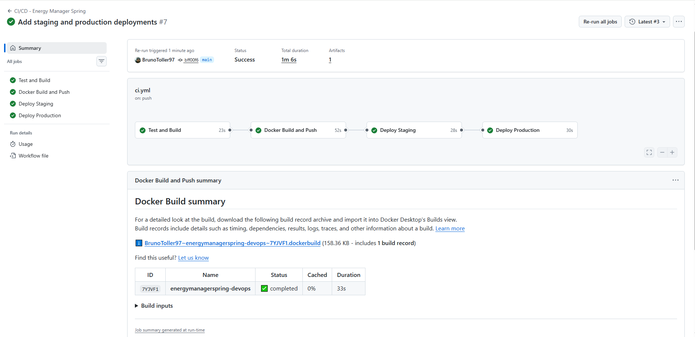
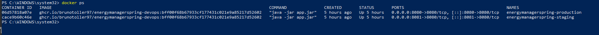
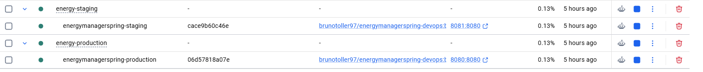
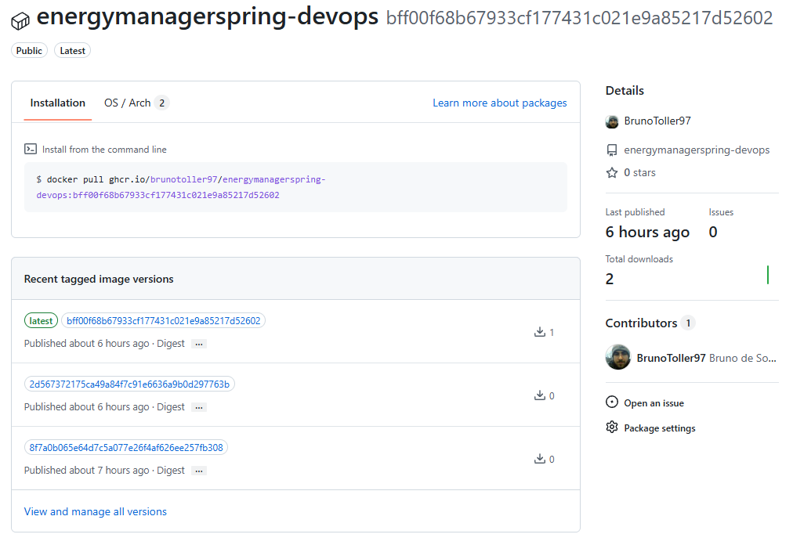

# Projeto - Cidades ESG Inteligentes

O Energy Manager Spring é uma aplicação desenvolvida em Java com Spring Boot para gerenciamento de informações relacionadas a setores, funcionários e usuários em um contexto de gestão ESG.

Nesta etapa do projeto foram aplicadas práticas de DevOps para automatizar o ciclo de integração, construção, containerização e deploy da aplicação. Também foram implementados testes automatizados para validar o comportamento da aplicação e os contratos das APIs REST.

## Como executar localmente com Docker

### Pré-requisitos

Para executar o projeto localmente é necessário possuir:

- Docker Desktop
- Docker Compose
- Git

### 1. Clonar o repositório

```bash
git clone https://github.com/BrunoToller97/energymanagerspring-devops.git
cd energymanagerspring-devops
```

### 2. Configurar as variáveis de ambiente

Crie um arquivo `.env` a partir do arquivo `.env.example`.

Exemplo:

```env
ENVIRONMENT=local
SPRING_PROFILE=default
APP_PORT=8080
APP_IMAGE=energymanagerspring:local

DB_URL=jdbc:oracle:thin:@oracle.fiap.com.br:1521:ORCL
DB_USER=SEU_USUARIO
DB_PASSWORD=SUA_SENHA

JWT_SECRET=SUA_CHAVE_SECRETA
SHOW_SQL=true
```

As credenciais reais não são armazenadas no repositório.

### 3. Construir a aplicação

```bash
docker compose build
```

### 4. Iniciar a aplicação

```bash
docker compose up -d
```

### 5. Verificar os containers

```bash
docker compose ps
```

A aplicação local utiliza por padrão:

`http://localhost:8080`

Para encerrar:

```bash
docker compose down
```

## Pipeline CI/CD

O projeto utiliza o GitHub Actions para implementar o pipeline de CI/CD.

O pipeline é definido no arquivo:

`.github/workflows/ci.yml`

O fluxo automatizado possui quatro etapas principais:

1. Test and Build
2. Docker Build and Push
3. Deploy Staging
4. Deploy Production

## Test and Build

Executado em um runner Linux disponibilizado pelo GitHub.

Nesta etapa são realizados:

- checkout do código;
- configuração do Java 21;
- execução dos testes automatizados com Maven;
- geração do pacote da aplicação.

Os testes utilizam um banco H2 em memória, evitando dependência do banco Oracle durante a etapa de CI.

### Testes Automatizados

Foram implementados testes automatizados para validar o funcionamento da aplicação, os cenários de autenticação e os contratos das APIs REST.

As principais tecnologias utilizadas nessa etapa são:

- **JUnit 5:** execução dos testes automatizados;
- **Cucumber:** implementação dos cenários BDD;
- **Gherkin:** descrição dos cenários em linguagem estruturada;
- **Rest Assured:** realização de requisições HTTP e validação das respostas;
- **JSON Schema Validator:** validação dos contratos JSON;
- **H2 Database:** banco de dados em memória utilizado no ambiente de testes.

### Testes BDD com Gherkin

Os cenários BDD estão definidos no arquivo:

`src/test/resources/features/autenticacao.feature`

Foram implementados quatro cenários para validar o processo de autenticação:

| Cenário | Tipo | Resultado esperado |
|---|---|---|
| Cadastro de usuário com dados válidos | Positivo | Cadastro realizado com sucesso |
| Cadastro de usuário com dados inválidos | Negativo | Requisição rejeitada |
| Login com credenciais válidas | Positivo | Autenticação realizada com sucesso |
| Login com e-mail inválido | Negativo | Autenticação rejeitada |

A implementação dos passos dos cenários está na classe:

`src/test/java/br/com/fiap/energymanagerspring/bdd/AutenticacaoSteps.java`

A configuração do Cucumber com Spring está definida em `CucumberSpringConfiguration.java`, enquanto a classe `CucumberTest.java` permite a execução dos cenários pelo JUnit Platform.

### Testes de API REST

Os testes de API são implementados com Rest Assured, realizando requisições HTTP aos endpoints da aplicação.

São validados três aspectos principais:

- **Status HTTP:** verificação dos códigos de resposta esperados;
- **Corpo da resposta JSON:** conferência dos dados retornados pelos endpoints;
- **Contrato JSON Schema:** validação da estrutura, dos campos obrigatórios e dos tipos de dados das respostas.

A classe responsável pelos testes de contrato é:

`src/test/java/br/com/fiap/energymanagerspring/ApiContractTests.java`

Os recursos contemplados pelos testes incluem:

| Recurso | Operações testadas |
|---|---|
| Autenticação (`/auth`) | Cadastro e login |
| Setores (`/api/setores`) | Criar, listar, consultar, atualizar e excluir |
| Funcionários (`/api/funcionarios`) | Criar, listar, consultar, atualizar e excluir |
| Usuários (`/api/usuarios`) | Criar, listar, consultar, atualizar e excluir |
| Endpoints demonstrativos | `/api/hello` e `/api/ola` |

### Contratos JSON Schema

Os arquivos JSON Schema estão organizados no diretório:

`src/test/resources/schemas/`

Esses arquivos definem a estrutura esperada para as respostas da API, permitindo identificar inconsistências como campos ausentes, tipos de dados incorretos e estruturas incompatíveis.

A validação dos contratos é realizada automaticamente durante a execução dos testes.

### Configuração do ambiente de testes

Para garantir que os testes sejam executados independentemente do banco de dados de desenvolvimento, foi configurado um perfil específico de testes.

Arquivo:

`src/test/resources/application-test.properties`

Nesse ambiente, é utilizado o banco H2 em memória, com configuração de compatibilidade com Oracle. A execução das migrações do Flyway é desabilitada durante os testes.

Dessa forma, os testes não dependem de uma conexão com o banco Oracle para sua execução.

### Como executar os testes localmente

Com o projeto aberto no terminal, execute:

**Windows (PowerShell):**

```powershell
.\mvnw clean test
```

**Linux/macOS:**

```bash
./mvnw clean test
```

O Maven Wrapper realiza a compilação e executa os testes automatizados, incluindo os cenários BDD e os testes de contrato da API.

Os relatórios da execução podem ser consultados no diretório:

`target/surefire-reports/`

Ao final de uma execução bem-sucedida, o Maven apresenta a mensagem:

```text
BUILD SUCCESS
```

### Integração dos testes ao CI/CD

Os testes automatizados fazem parte da etapa **Test and Build** do pipeline configurado no GitHub Actions.

Dessa forma, a execução dos testes ocorre antes da construção e publicação da imagem Docker e dos processos de deploy.

Essa integração permite identificar falhas de compilação, comportamento ou contrato da API antes que uma nova versão seja disponibilizada nos ambientes de implantação.

## Docker Build and Push

Após os testes serem concluídos com sucesso, uma imagem Docker é construída.

A imagem é publicada no GitHub Container Registry (GHCR):

`ghcr.io/brunotoller97/energymanagerspring-devops`

São utilizadas duas tags:

- `latest`
- SHA do commit

A utilização do SHA permite identificar exatamente qual versão da aplicação foi implantada.

## Deploy Staging

Após a criação da imagem, o pipeline executa automaticamente o deploy no ambiente de staging.

O deploy utiliza um self-hosted runner Windows conectado ao GitHub Actions.

Configuração do staging:

```env
ENVIRONMENT=staging
SPRING_PROFILE=staging
APP_PORT=8081
```

A aplicação de staging fica disponível em:

`http://localhost:8081`

## Deploy Production

O deploy de produção ocorre somente depois que o deploy de staging é concluído com sucesso.

Configuração:

```env
ENVIRONMENT=production
SPRING_PROFILE=prod
APP_PORT=8080
```

A aplicação de produção fica disponível em:

`http://localhost:8080`

As credenciais de banco de dados e JWT são armazenadas como GitHub Environment Secrets e não ficam expostas no código-fonte.

## Containerização

A aplicação foi containerizada utilizando Docker.

## Dockerfile

O projeto utiliza um Dockerfile multi-stage:

```dockerfile
FROM maven:3.9.9-eclipse-temurin-21 AS build

WORKDIR /app

COPY pom.xml .
COPY src ./src

RUN mvn clean package -DskipTests

FROM eclipse-temurin:21-jre-alpine

WORKDIR /app

COPY --from=build /app/target/energymanagerspring-0.0.1-SNAPSHOT.jar app.jar

RUN mkdir -p /app/logs

EXPOSE 8080

ENTRYPOINT ["java", "-jar", "app.jar"]
```

A estratégia de multi-stage build separa o ambiente utilizado para compilação do ambiente utilizado para executar a aplicação.

A primeira etapa utiliza Maven e Java 21 para gerar o arquivo JAR.

A segunda etapa utiliza somente o Java Runtime Environment necessário para executar a aplicação, reduzindo os componentes presentes na imagem final.

A opção `-DskipTests` evita a repetição dos testes durante a construção da imagem, pois eles já são executados anteriormente na etapa Test and Build do pipeline.

## Docker Compose

O Docker Compose é utilizado para orquestrar a execução da aplicação.

O arquivo `docker-compose.yml` configura:

- imagem Docker;
- porta da aplicação;
- variáveis de ambiente;
- volume para armazenamento de logs;
- rede Docker;
- política de reinicialização do container.

Foi criado o volume:

`energy-logs`

para persistência dos logs.

Também foi criada a rede:

`energy-network`

utilizando o driver `bridge`.

O banco Oracle é externo ao ambiente Docker e a conexão é fornecida à aplicação através de variáveis de ambiente.

## Prints do funcionamento

### Pipeline CI/CD

Pipeline completo executado com sucesso:



### Docker

Containers de staging e produção em execução:



### Staging/Production

Aplicação executando nos ambientes de staging e production:



### GitHub Container Registry

Imagem Docker publicada no GitHub Container Registry:



## Tecnologias utilizadas

- Java 21
- Spring Boot
- Maven
- JUnit 5
- Cucumber
- Gherkin
- Rest Assured
- JSON Schema Validator
- Spring Data JPA
- Spring Security
- JWT
- Oracle Database
- Flyway
- H2 Database
- Docker
- Docker Compose
- Git
- GitHub
- GitHub Actions
- GitHub Container Registry
- GitHub Environments
- Self-hosted GitHub Actions Runner
- PowerShell