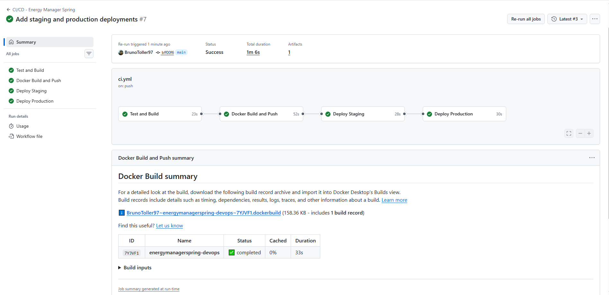
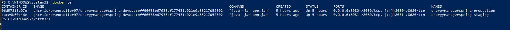
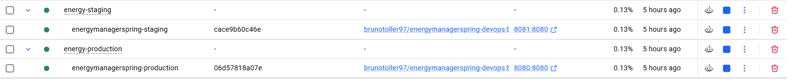
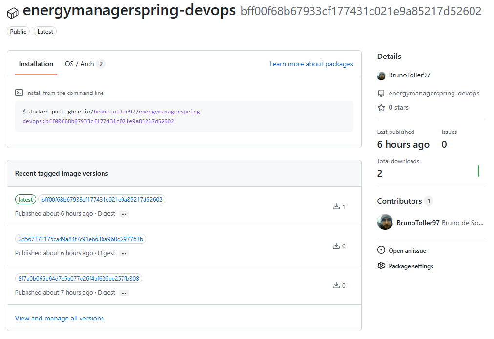

# Projeto - Cidades ESG Inteligentes

O Energy Manager Spring é uma aplicação desenvolvida em Java com Spring Boot para gerenciamento de informações relacionadas a setores, funcionários e usuários em um contexto de gestão ESG.

Nesta etapa do projeto foram aplicadas práticas de DevOps para automatizar o ciclo de integração, construção, containerização e deploy da aplicação.

## Como executar localmente com Docker

### Pré-requisitos

Para executar o projeto localmente é necessário possuir:

- Docker Desktop
- Docker Compose
- Git

### 1. Clonar o repositório

_git clone https://github.com/BrunoToller97/energymanagerspring-devops.git_

_cd energymanagerspring-devops_

### 2. Configurar as variáveis de ambiente
Crie um arquivo .env a partir do arquivo .env.example.
Exemplo:

_ENVIRONMENT=local_

_SPRING_PROFILE=default_

_APP_PORT=8080_

_APP_IMAGE=energymanagerspring:local_

_DB_URL=jdbc:oracle:thin:@oracle.fiap.com.br:1521:ORCL_

_DB_USER=SEU_USUARIO_

_DB_PASSWORD=SUA_SENHA_

_JWT_SECRET=SUA_CHAVE_SECRETA_

_SHOW_SQL=true_

As credenciais reais não são armazenadas no repositório.

### 3. Construir a aplicação
   
_docker compose build_

### 4. Iniciar a aplicação

_docker compose up -d_

### 5. Verificar os containers

_docker compose ps_

A aplicação local utiliza por padrão:

_http://localhost:8080_

Para encerrar:

_docker compose down_

## Pipeline CI/CD
O projeto utiliza o GitHub Actions para implementar o pipeline de CI/CD.

O pipeline é definido no arquivo:

_.github/workflows/ci.yml_

O fluxo automatizado possui quatro etapas principais:
1. Test and Build

2. Docker Build and Push

3. Deploy Staging

4. Deploy Production

## Test and Build
Executado em um runner Linux disponibilizado pelo GitHub.
Nesta etapa são realizados:
- checkout do código;
- configuração do Java 21;
- execução dos testes automatizados com Maven;
- geração do pacote da aplicação.
  
Os testes utilizam um banco H2 em memória, evitando dependência do banco Oracle durante a etapa de CI.

## Docker Build and Push

Após os testes serem concluídos com sucesso, uma imagem Docker é construída.

A imagem é publicada no GitHub Container Registry (GHCR):

_ghcr.io/brunotoller97/energymanagerspring-devops_

São utilizadas duas tags:

_latest_

_SHA do commit_

A utilização do SHA permite identificar exatamente qual versão da aplicação foi implantada.

## Deploy Staging
Após a criação da imagem, o pipeline executa automaticamente o deploy no ambiente de staging.

O deploy utiliza um self-hosted runner Windows conectado ao GitHub Actions.

Configuração do staging:

_ENVIRONMENT=staging_

_SPRING_PROFILE=staging_

_APP_PORT=8081_

A aplicação de staging fica disponível em:

_http://localhost:8081_

## Deploy Production
O deploy de produção ocorre somente depois que o deploy de staging é concluído com sucesso.

Configuração:

_ENVIRONMENT=production_

_SPRING_PROFILE=prod_

_APP_PORT=8080_

A aplicação de produção fica disponível em:

_http://localhost:8080_

As credenciais de banco de dados e JWT são armazenadas como GitHub Environment Secrets e não ficam expostas no código-fonte.

## Containerização
A aplicação foi containerizada utilizando Docker.

## Dockerfile
O projeto utiliza um Dockerfile multi-stage:

_FROM maven:3.9.9-eclipse-temurin-21 AS build_

_WORKDIR /app_

_COPY pom.xml .
COPY src ./src_

_RUN mvn clean package -DskipTests_

_FROM eclipse-temurin:21-jre-alpine_

_WORKDIR /app_

_COPY --from=build /app/target/energymanagerspring-0.0.1-SNAPSHOT.jar app.jar_

_RUN mkdir -p /app/logs_

_EXPOSE 8080_

_ENTRYPOINT ["java", "-jar", "app.jar"]_

A estratégia de multi-stage build separa o ambiente utilizado para compilação do ambiente utilizado para executar a aplicação.

A primeira etapa utiliza Maven e Java 21 para gerar o arquivo JAR.

A segunda etapa utiliza somente o Java Runtime Environment necessário para executar a aplicação, reduzindo os componentes presentes na imagem final.

## Docker Compose
O Docker Compose é utilizado para orquestrar a execução da aplicação.

O arquivo docker-compose.yml configura:
- imagem Docker;
- porta da aplicação;
- variáveis de ambiente;
- volume para armazenamento de logs;
- rede Docker;
- política de reinicialização do container.
  
Foi criado o volume:
  
_energy-logs_

para persistência dos logs.
Também foi criada a rede:

_energy-network_

utilizando o driver _bridge_.

O banco Oracle é externo ao ambiente Docker e a conexão é fornecida à aplicação através de variáveis de ambiente.

## Prints do funcionamento

### Pipeline CI/CD

Pipeline completo executado com sucesso:

### Docker

Containers de staging e produção em execução:

### Staging/Production

Aplicação executando no ambiente de staging e production:

### GitHub Container Registry

Imagem Docker publicada no GHCR:

## Tecnologias utilizadas
- Java 21
- Spring Boot
- Maven
- Spring Data JPA
- Spring Security
- JWT
- Oracle Database
- Flyway
- H2 Database
- Docker
- Docker Compose
- Git
- GitHub
- GitHub Actions
- GitHub Container Registry
- GitHub Environments
- Self-hosted GitHub Actions Runner
- PowerShell